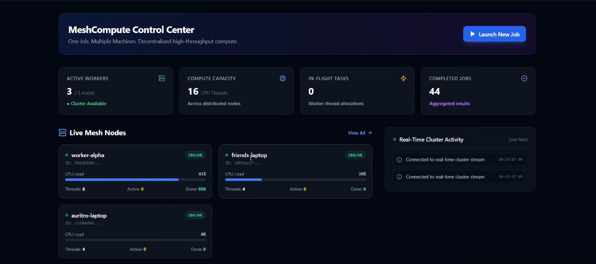
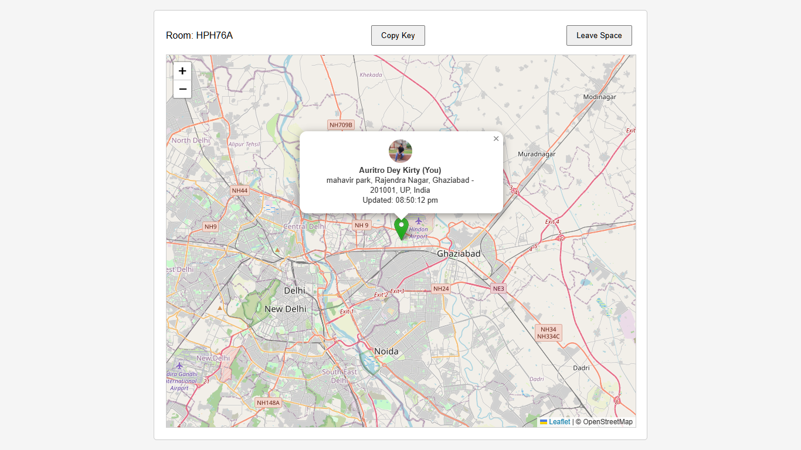
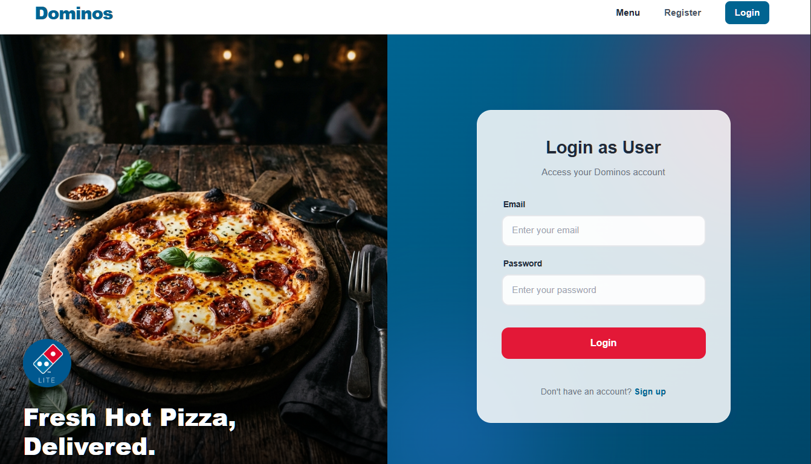
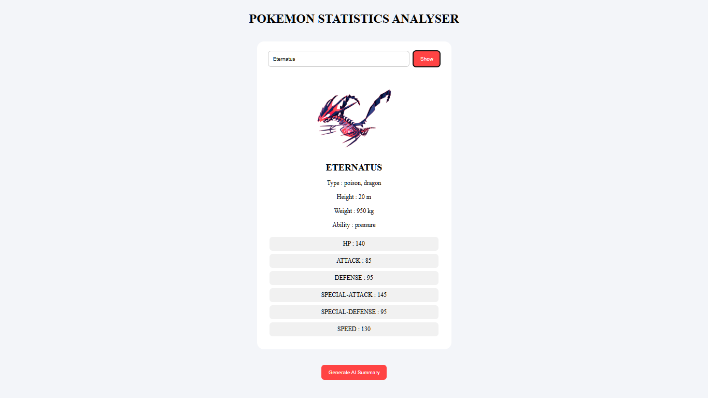

<div align="center">

# Hi, I'm Auritro Dey Kirty

### Full-Stack Developer • SDE Aspirant • Competitive Programmer

<p>
Building scalable distributed systems, real-time web applications, and AI-integrated products.
</p>

[](https://git.io/typing-svg)


<p align="center">
  <a href="https://auritrodeykirty07.github.io/Portfolio/" target="_blank">🌐 Portfolio</a> •
  <a href="https://www.linkedin.com/in/auritro-dey-kirty" target="_blank">💼 LinkedIn</a> •
  <a href="https://www.github.com/AuritroDeyKirty07" target="_blank">🐙 GitHub</a> •
  <a href="https://www.leetcode.com/u/AuritroDeyKirty" target="_blank">⚡ LeetCode</a> •
  <a href="mailto:deykirtyauritro@gmail.com">📬 Email</a>
</p>

</div>

---

# 👨‍💻 About Me

I am a **Computer Science Undergraduate** at **Guru Gobind Singh Indraprastha University (GGSIPU)** (CGPA: **8.255/10**) and a passionate **Full-Stack Developer** focused on building resilient, scalable, and API-driven systems.

From co-building **distributed computing networks** with fault-tolerant worker scheduling to crafting **real-time location tracking** and **e-commerce operations platforms with RBAC**, I take pride in taking complex technical concepts from architecture to deployment.

Alongside software engineering, I actively practice **Data Structures & Algorithms** (**469+ problems solved** across platforms with **333+ on LeetCode**, Contest Rating: **1529**). I recently ranked in the **Top 10 out of 130 teams** at **hackCBS 9.0** (SSCBS, University of Delhi).

### 🎯 Current Focus
- 🚀 **Seeking Software Development Engineer (SDE) or Full-Stack Internship Opportunities**
- ⚙️ Architecting distributed worker pools, event-driven backends, and real-time Socket.IO systems
- 🧠 Deepening knowledge in System Design, Backend Scalability, and Docker containerization
- 📈 Grinding toward 500+ DSA problems and 1600+ LeetCode rating

---

# 🛠️ Tech Stack

<div align="center">

### Languages
[](https://skillicons.dev)
<br>
<sub><b>C++ • C • Python • JavaScript (ES6+) • SQL</b></sub>

<br><br>

### Frontend Development
[](https://skillicons.dev)
<br>
<sub><b>React.js • React Router • Tailwind CSS • ShadCN UI • Zustand • Zod • Leaflet.js</b></sub>

<br><br>

### Backend, Databases & Real-Time
[](https://skillicons.dev)
<br>
<sub><b>Node.js • Express.js • REST APIs • Socket.IO • JWT Auth • MongoDB • Mongoose • Firebase (Auth, Firestore)</b></sub>

<br><br>

### AI Integration & Developer Tools
[](https://skillicons.dev)
<br>
<sub><b>Google Gemini API • Hugging Face • Git • GitHub • Vercel • Postman • Docker • Axios • OAuth</b></sub>

</div>

---

# 🏆 Achievements & Certifications

- 🥇 **Top 10 Finalist (out of 130 teams)** — **hackCBS 9.0** *(SSCBS, University of Delhi | 24-Hour National Hackathon, Nov 2026)*: Built MeshCompute AI, a distributed computing engine.
- 💡 **469+ DSA Problems Solved** across competitive programming platforms (**LeetCode: 333+ Solved**, **1529 Contest Rating**).
- 📜 **Full Stack Development with AI Certification (45 Days)** — Brain Mentors, New Delhi *(June – July 2026)*.
- 📜 **freeCodeCamp Responsive Web Design Certification** *(April 2026)*.
- 📜 **HackerRank SQL (Intermediate) Certification** *(June 2024)*.

---

# 🚀 Featured Projects

<table>

<tr>

<!-- Project 1: MeshCompute AI -->
<td width="50%" valign="top">

<h3 align="center">⚡ MeshCompute AI</h3>
<p align="center">
  <b>Distributed Computing & Task Scheduling Platform</b>
  <br>
  
</p>

<p align="center">
  <a href="https://github.com/AuritroDeyKirty07/hackCBS9.0">
    
  </a>
</p>

<p align="center">
  <b>Node.js • Express • Socket.IO • MongoDB • React • Gemini API</b>
</p>

<ul>
  <li><b>Distributed Architecture:</b> Central coordinator decomposes complex computational jobs into discrete tasks, scheduling them dynamically across worker agents based on real-time CPU capacity and load.</li>
  <li><b>Worker Threads & Fault Tolerance:</b> Worker agents execute tasks concurrently using Node.js worker threads; engineered heartbeat-driven failure detection with automatic task retries and reassignments.</li>
  <li><b>AI Job Compilation:</b> Leveraged Google Gemini API for natural-language job compilation with Zod validation and rule-based fallback, monitored via a real-time React dashboard.</li>
</ul>

<p align="center">
  <a href="https://github.com/AuritroDeyKirty07/hackCBS9.0">
    
  </a>
</p>

</td>

<!-- Project 2: Live Web Tracker -->
<td width="50%" valign="top">

<h3 align="center">📍 Live Web Tracker</h3>
<p align="center">
  <b>Real-Time Location Sharing & Geospatial Platform</b>
  <br>
  
</p>

<p align="center">
  <a href="https://github.com/AuritroDeyKirty07/live-web-tracker-app">
    
  </a>
</p>

<p align="center">
  <b>JavaScript • Firebase Auth • Firestore • Leaflet.js • Geolocation API</b>
</p>

<ul>
  <li><b>Private Room Synchronization:</b> Built a real-time room-based location sharing application allowing concurrent users to collaborate within private, isolated map rooms.</li>
  <li><b>State Management & Cleanup:</b> Google OAuth authentication via Firebase; synced live coordinates across clients with Firestore snapshot listeners and automatic marker cleanup upon user disconnect.</li>
  <li><b>Geocoding Integration:</b> Integrated Geoapify API for on-the-fly reverse geocoding from raw coordinates into precise human-readable street addresses.</li>
</ul>

<p align="center">
  <a href="https://github.com/AuritroDeyKirty07/live-web-tracker-app">
    
  </a>
  <a href="https://live-web-tracker-app.vercel.app/" target="_blank">
    
  </a>
</p>

</td>

</tr>

<tr>

<!-- Project 3: Domino's Food Ordering Platform -->
<td width="50%" valign="top">

<h3 align="center">🍕 Domino's Food Ordering & Operations</h3>
<p align="center">
  <b>Full-Stack MERN E-Commerce & Restaurant Platform</b>
  <br>
  
</p>

<p align="center">
  <a href="https://github.com/AuritroDeyKirty07/dominos-web-app">
    
  </a>
</p>

<p align="center">
  <b>React.js • Node.js • Express.js • MongoDB • JWT • RBAC</b>
</p>

<ul>
  <li><b>Role-Based Access Control (RBAC):</b> Implemented secure JWT-based authentication and role-based authorization middleware protecting administrative endpoints and managerial workflows.</li>
  <li><b>End-to-End REST APIs:</b> Designed Express.js and MongoDB REST APIs for authentication, menu catalog, cart operations, and order lifecycle management.</li>
  <li><b>Collaborative Engineering:</b> Followed Git/GitHub feature-branching workflows and resolved merge conflicts to maintain a modular, production-ready codebase.</li>
</ul>

<p align="center">
  <a href="https://github.com/AuritroDeyKirty07/dominos-web-app">
    
  </a>
  <a href="https://dominos-web-app-live.vercel.app" target="_blank">
    
  </a>
</p>

</td>

<!-- Project 4: Pokémon Battle Simulator -->
<td width="50%" valign="top">

<h3 align="center">🎮 Pokémon Battle Simulator & Analyser</h3>
<p align="center">
  <b>Turn-Based Battle Engine & AI Stat Analyser</b>
  <br>
  
</p>

<p align="center">
  <a href="https://github.com/AuritroDeyKirty07/pokemon-battle-simulator">
    
  </a>
</p>

<p align="center">
  <b>JavaScript • PokéAPI • Gemini API • CSS3 Animations</b>
</p>

<ul>
  <li><b>Turn-Based Engine:</b> Dynamic combat engine with live HP tracking, elemental type-effectiveness matchup matrix, and battle-state transitions.</li>
  <li><b>AI Battle Strategy:</b> Integrated Google Gemini API to analyze in-depth Pokémon stat distributions and generate strategic tactical recommendations.</li>
  <li><b>Dynamic DOM & Animations:</b> Optimized rendering cycles and custom CSS keyframe animations for high-performance visual effects.</li>
</ul>

<p align="center">
  <a href="https://github.com/AuritroDeyKirty07/pokemon-battle-simulator">
    
  </a>
  <a href="https://auritrodeykirty07.github.io/pokemon-battle-simulator/" target="_blank">
    
  </a>
</p>

</td>

</tr>

</table>

---

# ⚡ Competitive Programming

<div align="center">

<table>

<tr>

<td align="center" width="33%">

### 💡 LeetCode
**333+ Problems Solved**  
**Contest Rating: 1529**  
Consistent daily DSA problem solving across Arrays, Trees, Graphs, and Dynamic Programming.  
<br>
<a href="https://www.leetcode.com/u/AuritroDeyKirty" target="_blank">
  
</a>

</td>

<td align="center" width="33%">

### 📜 HackerRank
**SQL (Intermediate) Certified**  
Proficient in complex queries, joins, window functions, and database design concepts.  
<br>
<a href="https://www.hackerrank.com" target="_blank">
  
</a>

</td>

<td align="center" width="33%">

### 🎯 Core Competencies
**469+ Total Problems Solved**  
Data Structures & Algorithms  
Object-Oriented Programming (OOP)  
Operating Systems & DBMS  
Computer Networks & MVC  

</td>

</tr>

</table>

</div>

---

# 📊 GitHub Analytics

<div align="center">


</div>

<br>

<div align="center">


</div>

---

# 📈 Contribution Activity

<div align="center">

[](https://github.com/Ashutosh00710/github-readme-activity-graph)

</div>

---

# 🐍 Contribution Snake

<div align="center">


</div>

---

# 📌 Repositories Index

| Repository | Tech Stack | Highlights | Links |
|:-----------|:-----------|:-----------|:------|
| **[hackCBS9.0](https://github.com/AuritroDeyKirty07/hackCBS9.0)** | Node.js, Express, Socket.IO, MongoDB, React, Gemini API | Distributed computing platform with worker threads, heartbeat fault tolerance & Gemini job compilation (Top 10 Finalist) | [Repo](https://github.com/AuritroDeyKirty07/hackCBS9.0) |
| **[dominos-web-app](https://github.com/AuritroDeyKirty07/dominos-web-app)** | React.js, Node.js, Express.js, MongoDB, JWT | Full-Stack MERN food ordering & restaurant operations platform with RBAC & REST APIs | [Repo](https://github.com/AuritroDeyKirty07/dominos-web-app) • [Demo](https://dominos-web-app-live.vercel.app) |
| **[live-web-tracker-app](https://github.com/AuritroDeyKirty07/live-web-tracker-app)** | JavaScript, Firebase Auth, Firestore, Leaflet.js | Real-time room-based location sharing with live Firestore listeners & Geoapify reverse geocoding | [Repo](https://github.com/AuritroDeyKirty07/live-web-tracker-app) • [Demo](https://live-web-tracker-app.vercel.app/) |
| **[pokemon-battle-simulator](https://github.com/AuritroDeyKirty07/pokemon-battle-simulator)** | JavaScript, PokéAPI, Gemini API, CSS3 | Turn-based battle simulator with elemental matchup mechanics & AI strategic analysis | [Repo](https://github.com/AuritroDeyKirty07/pokemon-battle-simulator) • [Demo](https://auritrodeykirty07.github.io/pokemon-battle-simulator/) |
| **[porsche-website-frontend](https://github.com/AuritroDeyKirty07/porsche-website-frontend)** | HTML5, CSS3, JavaScript | Responsive luxury automotive showcase website with modern UI aesthetics | [Repo](https://github.com/AuritroDeyKirty07/porsche-website-frontend) |
| **[crav-burger-frontend](https://github.com/AuritroDeyKirty07/crav-burger-frontend)** | HTML5, CSS3, JavaScript | Modern, component-driven responsive restaurant landing page | [Repo](https://github.com/AuritroDeyKirty07/crav-burger-frontend) |

---

# 🤝 Let's Connect

<div align="center">

<a href="https://auritrodeykirty07.github.io/Portfolio/" target="_blank">
  
</a>

<a href="https://www.linkedin.com/in/auritro-dey-kirty" target="_blank">
  
</a>

<a href="mailto:deykirtyauritro@gmail.com">
  
</a>

<a href="https://www.leetcode.com/u/AuritroDeyKirty" target="_blank">
  
</a>

<a href="https://github.com/AuritroDeyKirty07">
  
</a>

</div>

---

<div align="center">

```cpp
while (alive) {
    Learn();
    Build();
    Debug();
    Repeat();
}
```

### Thanks for visiting! ⭐ Star any repositories you find interesting.


</div>
